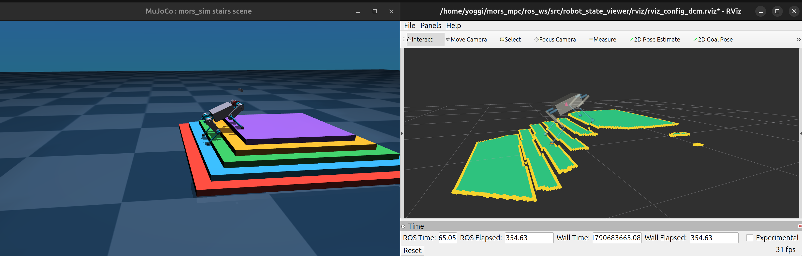

# Open-Source MPC + WBIC Quadruped Locomotion Controller

[](LICENSE)


**English** | [Русский](README_rus.md)


An open-source C++ implementation of **Convex Model Predictive Control (MPC)** and **Whole-Body Impulse Control (WBIC)** for quadruped robots, following the approach of the Mini Cheetah controllers. The stack includes **vision-based (perceptive) locomotion** with a height map and appropriate foothold selection. The controller is simulated in **[MuJoCo](https://mujoco.org/)** and has a **[ROS 2](https://docs.ros.org/en/jazzy/index.html)** interface.

This project is a ready-to-run, has modern stack (Ubuntu 24.04, ROS 2 Jazzy, MuJoCo) and is best suitable for students and researchers who want to study, reproduce or extend MPC + WBIC locomotion (from blind walking on flat ground to perceptive stair climbing) without building everything from scratch.

Developed for the [MORS](https://docs.voltbro.ru/mors/) small-sized quadruped robot.



<table align='center'>
  <tr width="100%">
    <td width="33%"><p align='center'>Stairs</p></td>
    <td width="33%"><p align='center'>Random Boards</p></td>
    <td width="33%"><p align='center'>Obstacle 12 cm</p></td>
  </tr>
</table>

Here is the links to some video demonstrations:
- [WBIC+MPC Sim](https://youtu.be/28EshOERJ94?si=7QsEtfh_oUpAAv3s)
- [Perceptive Locomotion Sim](https://youtu.be/7v6B-Jk0Igc?si=pUrnqSeW1RmC9CoY)
- [Hardware Demo 1](https://youtu.be/D1mmPATnWWc?si=KQ7ofDW2pKZ5wxwb)
- [Hardware Demo 2](https://youtu.be/FQ2Tz_Jyjow?si=RDnW18rQ6wOK19I2)

The control algorithm is based on the following publications:

- Di Carlo, Jared, et al. "Dynamic locomotion in the mit cheetah 3 through convex model-predictive control." 2018 IEEE/RSJ international conference on intelligent robots and systems (IROS). IEEE, 2018. [Link](https://dspace.mit.edu/handle/1721.1/138000)

- Kim, Donghyun, et al. "Highly dynamic quadruped locomotion via whole-body impulse control and model predictive control." arXiv preprint arXiv:1909.06586, 2019. [Link](https://arxiv.org/abs/1909.06586)

- Kim, Donghyun et al. “Vision Aided Dynamic Exploration of Unstructured Terrain with a Small-Scale Quadruped Robot.” 2020 IEEE International Conference on Robotics and Automation (ICRA) (2020): 2464-2470. [Link](https://dspace.mit.edu/entities/publication/580c4721-a611-4d73-8b53-53a58434aebf)

## Features

- **Convex MPC** with a single rigid body model for ground reaction force planning
- **WBIC** converts MPC reaction forces and task-space references into joint torques based on CLIK and QP optimization
- **Perceptive locomotion** builds a height map from a depth camera (tested on Intel RealSense D435i); footholds are adjusted to terrain height and moved to steppable cells
- **Blind and vision modes** are switchable with a single config parameter
- Rigid-body kinematics and dynamics computed via **[Pinocchio](https://github.com/stack-of-tasks/pinocchio)**
- **[MuJoCo simulation](https://mujoco.org/)** with 7 test terrains: stairs, ramp, boxes, stumps, boards, patch, flat
- **[ROS 2 Jazzy](https://docs.ros.org/en/jazzy/index.html)** interface with keyboard teleoperation
- **[LCM](https://github.com/lcm-proj/lcm)** for internal communication
- Gait parameters such as body height, swing time and stride height tunable on the fly
- Telemetry logger to CSV, ready for [PlotJuggler](https://github.com/plotjuggler/plotjuggler)
- One-command install and launch (`install.sh`, `run.sh`)

## Requirements

- Ubuntu 24.
- [ROS 2 Jazzy Desktop](https://docs.ros.org/en/jazzy/index.html) (`/opt/ros/jazzy`)
- `sudo` access

## Quick Start

### Installation

```bash
cd ~
git clone https://github.com/voltdog/mors_quadruped.git
cd mors_quadruped
chmod +x install.sh run.sh
./install.sh
source ~/.bashrc
```

### Launch

Start the simulator together with the locomotion controller:

```bash
./run.sh --sim
```

Start with the logger enabled:

```bash
./run.sh --sim --log
```

If you want to watch the heightmap in rviz:

```bash
./run.sh --sim --rviz
```


After launch, wait until the following message appears in the console:
```
[LocomotionController]: Started
```

Then run the following in a second terminal:

```bash
ros2 run mors_keyboard_control mors_keyboard_control
```

Rviz-config for the heightmap visualization is located in `ros_ws/src/robot_state_viewer/rviz/rviz_config.rviz`.

## Keyboard Control

Main keys:

- `Enter` - stand up / lie down.
- `Space` - switch between `STANDING_MODE` and `LOCOMOTION_MODE`.
- `W/S` - move forward/backward.
- `Q/E` - move left/right.
- `A/D` - turn.
- `1..9` - maximum speed from `0.1` to `0.9`.
- `Arrow Up/Down` - adjust body height.
- `Ctrl + Arrow Up/Down` - adjust swing time.
- `Shift + Arrow Up/Down` - adjust step height.

## Viewing Logs

If you use the `--log` flag when starting the robot, the `MorsLogger` module is enabled during execution and continuously writes data from all LCM channels to CSV files in the `~/mors_logs` directory. Logging stops automatically after 120 seconds.
For plotting and log inspection, [plotjuggler](https://github.com/facontidavide/PlotJuggler) is convenient to use.

## Configuration

All configuration files are located in the `config` directory.
Main files:
- Locomotion controller parameters (MPC, WBIC, swing controller, gait scheduler) - `locomotion_controller.yaml`
- Simulation parameters - `simulation.yaml`
- Robot physical parameters and maximum/minimum allowed joint angles - `robot.yaml`
- Sensor parameters (contact sensors, RealSense T265 and D435i) - `sensors.yaml`

It is not recommended to modify the other config files.

The path to the configs is defined by the `CONFIGPATH` variable (it is configured automatically by `install.sh`).

## Choose the Control Algorithm

The control algorithm is selected by the `algorithm` parameter in `config/locomotion_controller.yaml`:

- `wbic` - MPC + WBIC without vision (blind locomotion).
- `vision` - MPC + WBIC with the height map from `HeightMapBuilder`: footholds are adjusted to the terrain height and moved to steppable cells.

## Render Quality

There are two render quality modes: `low` and `high`. The default is `low`. In this mode, rendering shadows, reflections and sky box is turned off. This allows to significantly increase the simulation speed on less powerful machines. If you have a good GPU and want to see better graphics, you can switch to `high` mode.

You can choose render quality in the file `config/simulation.yaml`. Simply change the parameter `render_quality` from `low` to `high`. This parameter turns on rendering shadows, reflections and sky box. 

## Choose the Robot Environment

The environment type is loaded by the `scene` parameter in `config/simulation.yaml`. You can choose one of the following environments:

- `flat`
- `stairs`
- `patch`
- `boxes`
- `ramp`
- `boards`
- `stumps`

Try different environments and motion parameters using the hotkeys and see how the robot handles various obstacles.


## Project Structure

```text
.
├── common
├── config
├── HeightMapBuilder
├── lcm_msgs
├── LocomotionController
├── MorsLogger
├── ros_ws/src/mors_keyboard_control
├── ros_ws/src/robot_mode_controller
├── ros_ws/src/mors_ros_msgs
├── ros_ws/src/robot_state_viewer
├── Simulator
├── run.sh
└── install.sh
```

## Component Overview

- `common` - shared C++ types, utility functions, leg models, and URDF files.
- `config` - YAML configs for the controller, simulation, safety limits, and channels.
- `lcm_msgs` - `.lcm` message definitions and [LCM](https://lcm-proj.github.io/lcm/) type generation (`lcm_gen.sh`).
- `HeightMapBuilder` - C++ vision-based height map builder (`height_map_builder`).
- `LocomotionController` - the main C++ controller containing MPC and WBIC(`locomotionControllerMPC`).
- `MorsLogger` - C++ telemetry logger (`mors_logger`).
- `ros_ws/src/mors_ros_msgs` - ROS 2 interfaces (`GaitParams.msg`, `RobotCmd.srv`).
- `ros_ws/src/robot_mode_controller` - ROS 2 node for modes and actions.
- `ros_ws/src/mors_keyboard_control` - ROS 2 keyboard control node.
- `ros_ws/src/robot_state_viewer` - ROS 2 node for visualizing the robot state and the height map in rviz.
- `Simulator` - MuJoCo simulator with [LCM](https://lcm-proj.github.io/lcm/) communication.
- `run.sh` - script for launching the main components.
- `install.sh` - dependency installation, build, and environment setup.

## Manual Rebuild (If Needed)

```bash
cd lcm_msgs
bash lcm_gen.sh

source /opt/ros/jazzy/setup.bash
cd ../ros_ws
colcon build --symlink-install --packages-select mors_ros_msgs robot_mode_controller mors_keyboard_control robot_state_viewer
cd ..

cmake -S LocomotionController -B LocomotionController/build -DCMAKE_BUILD_TYPE=Release
cmake --build LocomotionController/build -j"$(nproc)"

cmake -S MorsLogger -B MorsLogger/build -DCMAKE_BUILD_TYPE=Release
cmake --build MorsLogger/build -j"$(nproc)"

cmake -S HeightMapBuilder -B HeightMapBuilder/build -DCMAKE_BUILD_TYPE=Release
cmake --build HeightMapBuilder/build -j"$(nproc)"
```

## Publications

If you use this work in an academic context, please cite one of the following publications:


- Budanov V., Danilov V., Kapytov D., Klimov K. (2025). MORS: BLDC BASED SMALL SIZED QUADRUPED ROBOT. Journal of Computer and System Sciences International. no. 3, pp.152-176 DOI: 10.7868/S3034644425030146

- В. М. Буданов, В. А. Данилов, Д. В. Капытов, and К. В. Климов. Малогабаритный четырехногий шагающий робот на базе бесколлекторных моторов. Известия Российской академии наук. Теория и системы управления, (3):152–176, 2025. 

