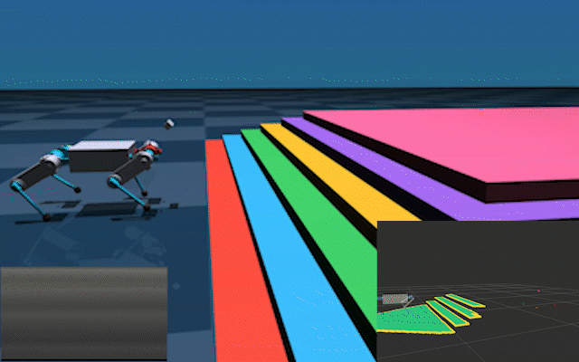
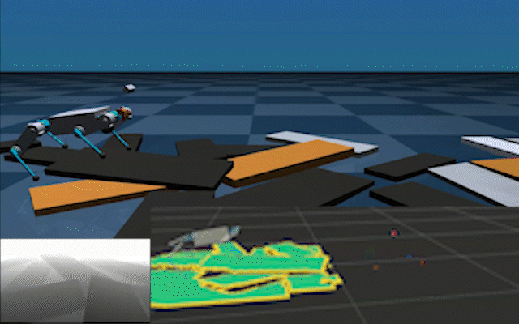
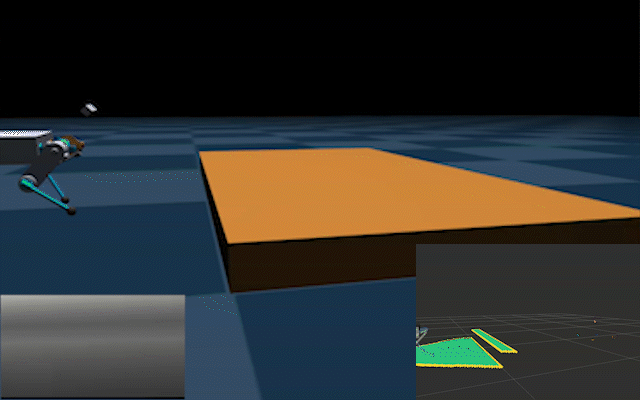
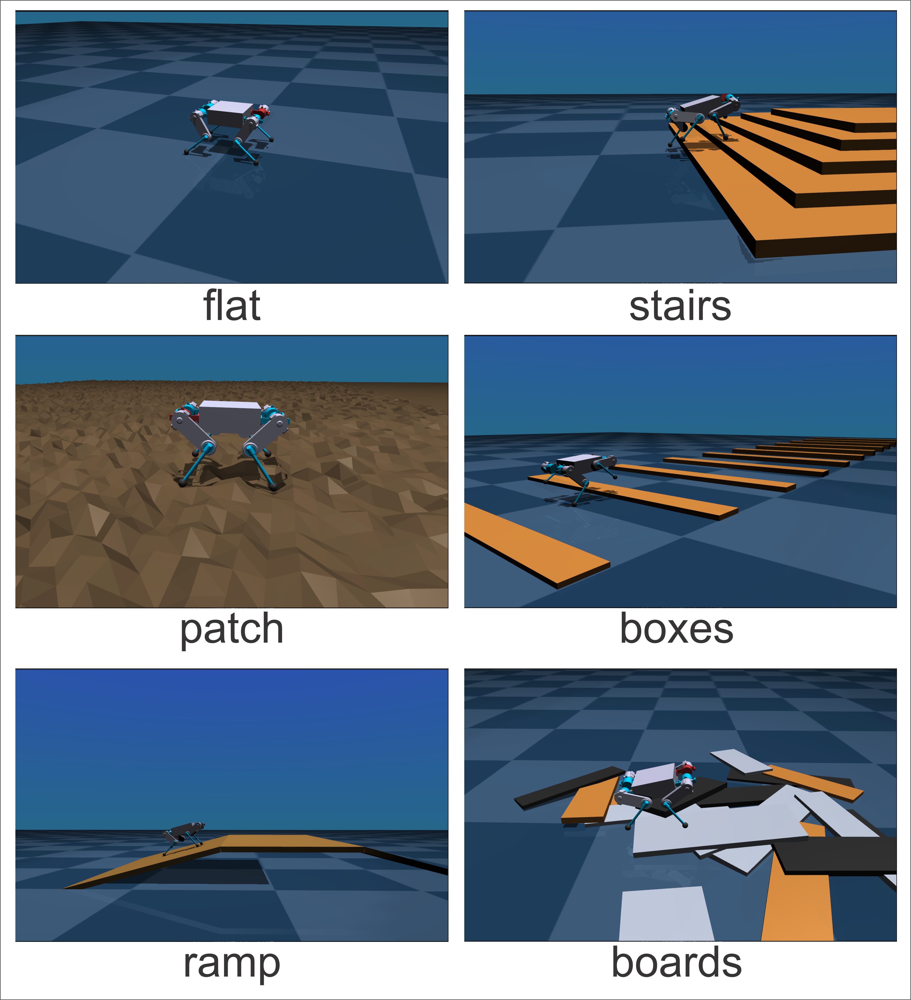

# Открытый контроллер локомоции четырехногого робота на основе MPC + WBIC

[](LICENSE)


[](https://doi.org/10.5281/zenodo.23662782)

[English](README.md) | **Русский**


 Реализация на C++ **Convex Model Predictive Control (MPC)** и **Whole-Body Impulse Control (WBIC)** для четырехногих роботов, сделанных на подобие Mini Cheetah. Стек управления дополнительно включает **техническое зрение** для построения карты высот и выбора подходящих точек постановки стоп. Контроллер симулируется в **[MuJoCo](https://mujoco.org/)** и имеет **[ROS 2](https://docs.ros.org/en/jazzy/index.html)**-интерфейс.

Проект готов к запуску, использует современный стек (Ubuntu 24.04, ROS 2 Jazzy, MuJoCo) и лучше всего подходит студентам и исследователям, которые хотят изучать, воспроизводить или развивать подходы к ходьбе на основе MPC + WBIC (от слепого движения по ровной поверхности до подъема по лестнице с использованием зрения), не создавая все с нуля.

Разработан для малогабаритного четырехногого робота [МОРС](https://docs.voltbro.ru/mors/).

<table align='center'>
  <tr width="100%">
    <td width="33%"><p align='center'>Лестница</p></td>
    <td width="33%"><p align='center'>Случайные доски</p></td>
    <td width="33%"><p align='center'>Препятствие 12 см</p></td>
  </tr>
</table>

Ссылки на видеодемонстрации:
- [WBIC+MPC в симуляции](https://youtu.be/28EshOERJ94?si=7QsEtfh_oUpAAv3s)
- [Локомоция с техническим зрением в симуляции](https://youtu.be/7v6B-Jk0Igc?si=pUrnqSeW1RmC9CoY)
- [Демонстрация на реальном роботе 1](https://youtu.be/D1mmPATnWWc?si=KQ7ofDW2pKZ5wxwb)
- [Демонстрация на реальном роботе 2](https://youtu.be/FQ2Tz_Jyjow?si=RDnW18rQ6wOK19I2)

Алгоритм управления основан на следующих публикациях:

- Di Carlo, Jared, et al. "Dynamic locomotion in the mit cheetah 3 through convex model-predictive control." 2018 IEEE/RSJ international conference on intelligent robots and systems (IROS). IEEE, 2018. [Link](https://dspace.mit.edu/handle/1721.1/138000)

- Kim, Donghyun, et al. "Highly dynamic quadruped locomotion via whole-body impulse control and model predictive control." arXiv preprint arXiv:1909.06586, 2019. [Link](https://arxiv.org/abs/1909.06586)

- Kim, Donghyun et al. “Vision Aided Dynamic Exploration of Unstructured Terrain with a Small-Scale Quadruped Robot.” 2020 IEEE International Conference on Robotics and Automation (ICRA) (2020): 2464-2470. [Link](https://dspace.mit.edu/entities/publication/580c4721-a611-4d73-8b53-53a58434aebf)

## Возможности

- **Convex MPC** с моделью единичного твердого тела (SRBD) для планирования сил реакции опоры
- **WBIC** преобразует силы реакции из MPC и команды в декартовом пространстве в моменты в сочленениях, используя CLIK и QP-оптимизацию
- **Техническое зрение** используется для построения карты высот по данным камеры глубины (проверено на Intel RealSense D435i); точки постановки стоп корректируются по высоте рельефа и смещаются на пригодные для опоры ячейки
- **Слепой режим и режим со зрением** переключаются одним параметром конфигурации
- Кинематика и динамика твердых тел рассчитываются с помощью **[Pinocchio](https://github.com/stack-of-tasks/pinocchio)**
- **[Симуляция в MuJoCo](https://mujoco.org/)** с 7 тестовыми окружениями: stairs, ramp, boxes, stumps, boards, patch, flat
- **[ROS 2 Jazzy](https://docs.ros.org/en/jazzy/index.html)**-интерфейс с управлением с клавиатуры
- **[LCM](https://github.com/lcm-proj/lcm)** для внутреннего обмена данными
- Параметры походки, такие как высота корпуса, время переноса ноги и высота шага, настраиваются на лету
- Сохранение телеметрии в CSV, для последующего анализа [PlotJuggler](https://github.com/plotjuggler/plotjuggler) или любом другом ПО для построения графиков
- Установка и запуск осуществляются одной командой (`install.sh`, `run.sh`)

## Требования

- Ubuntu 24.04
- [ROS 2 Jazzy Desktop](https://docs.ros.org/en/jazzy/index.html) (`/opt/ros/jazzy`)
- доступ к `sudo`

## Быстрый старт

### Установка

```bash
cd ~
git clone https://github.com/voltdog/mors_quadruped.git
cd mors_quadruped
chmod +x install.sh run.sh
./install.sh
source ~/.bashrc
```

### Запуск

Запуск симулятора вместе с контроллером локомоции:

```bash
./run.sh --sim
```

Запуск вместе с логгером:

```bash
./run.sh --sim --log
```

Запуск с визуализацией карты высот в rviz:

```bash
./run.sh --sim --rviz
```

После запуска обязательно дождитесь вывода в консоль:
```
[LocomotionController]: Started
```

После этого введите во втором терминале:

```bash
ros2 run mors_keyboard_control mors_keyboard_control
```

Если вы запустили с ключом `--rviz`, то в третьем терминале запустите:

```bash
rviz2
```

Rviz-конфиг для визуализации карты высот находится в `ros_ws/src/robot_state_viewer/rviz/rviz_config.rviz`.

## Управление с клавиатуры

Основные клавиши:

- `Enter` - встать / лечь.
- `Space` - переключение `STANDING_MODE` / `LOCOMOTION_MODE`.
- `W/S` - движение вперед/назад.
- `Q/E` - движение влево/вправо.
- `A/D` - поворот.
- `1..9` - максимальная скорость от `0.1` до `0.9`.
- `Arrow Up/Down` - изменение высоты корпуса.
- `Ctrl + Arrow Up/Down` - изменение времени переноса ноги.
- `Shift + Arrow Up/Down` - изменение высоты шага.

## Просмотр логов

Если вы используете ключ `--log` при запуске робота, то во время выполнения программы включается модуль `MorsLogger` и начинает постоянную запись данных из всех LCM-каналов в CSV-файлы в папку `~/mors_logs`. Запись автоматически останавливается через 120 секунд.
Для просмотра графиков удобно пользоваться [plotjuggler](https://github.com/facontidavide/PlotJuggler).

## Конфигурация

Все файлы конфигурации находятся в папке `config`.
Список основных файлов:
- Параметры контроллера локомоции (MPC, WBIC, swing-контроллер, планировщик походки) - `locomotion_controller.yaml`
- Параметры симуляции - `simulation.yaml`
- Физические параметры робота и максимально/минимально допустимые углы суставов - `robot.yaml`
- Параметры датчиков (датчики контакта, RealSense T265 и D435i) - `sensors.yaml`

Остальные файлы конфигурации изменять не рекомендуется.

Путь к конфигам задается переменной `CONFIGPATH` (ее автоматически настраивает `install.sh`).

## Выбор алгоритма управления

Алгоритм управления задается параметром `algorithm` в файле `config/locomotion_controller.yaml`:

- `wbic` - MPC + WBIC без технического зрения (слепая локомоция).
- `vision` - MPC + WBIC с картой высот от `HeightMapBuilder`: точки постановки стоп корректируются по высоте рельефа и смещаются на пригодные для опоры ячейки.

## Качество рендеринга

Доступны два режима качества рендеринга: `low` и `high`. По умолчанию используется `low`: в этом режиме отключены тени, отражения и небо Это позволяет значительно повысить скорость симуляции на слабых компьютерах. Если у вас хорошая видеокарта и вы хотите видеть более качественную графику, переключитесь в режим `high`.

Качество рендеринга задается параметром `render_quality` в файле `config/simulation.yaml`. Значение `high` включает тени, отражения и визуализацию неба.

## Смена окружения робота

За тип окружения отвечает параметр `scene` в файле `config/simulation.yaml`. Вы можете выбрать следующие окружения:

- `flat`
- `stairs`
- `patch`
- `boxes`
- `ramp`
- `boards`
- `stumps`

Поэкспериментируйте с разными окружениями и параметрами движения с помощью горячих клавиш и посмотрите, как робот преодолевает различные препятствия.



## Структура проекта

```text
.
├── common
├── config
├── HeightMapBuilder
├── lcm_msgs
├── LocomotionController
├── MorsLogger
├── ros_ws/src/mors_keyboard_control
├── ros_ws/src/robot_mode_controller
├── ros_ws/src/mors_ros_msgs
├── ros_ws/src/robot_state_viewer
├── Simulator
├── run.sh
└── install.sh
```

## Что за что отвечает

- `common` - общие C++ типы, вспомогательные функции, модели ног и URDF.
- `config` - YAML-конфиги контроллера, симуляции, аварийных ограничений и каналов.
- `lcm_msgs` - `.lcm` описания сообщений и генерация [LCM](https://lcm-proj.github.io/lcm/)-типов (`lcm_gen.sh`).
- `HeightMapBuilder` - C++ построитель карты высот по данным камеры глубины (`height_map_builder`).
- `LocomotionController` - основной C++ контроллер, содержащий MPC и WBIC (`locomotionControllerMPC`).
- `MorsLogger` - C++ логгер телеметрии (`mors_logger`).
- `ros_ws/src/mors_ros_msgs` - ROS 2 интерфейсы (`GaitParams.msg`, `RobotCmd.srv`).
- `ros_ws/src/robot_mode_controller` - ROS 2 узел режимов/действий.
- `ros_ws/src/mors_keyboard_control` - ROS 2 узел управления с клавиатуры.
- `ros_ws/src/robot_state_viewer` - ROS 2 узел визуализации состояния робота и карты высот в rviz.
- `Simulator` - MuJoCo-симулятор с [LCM](https://lcm-proj.github.io/lcm/)-обменом.
- `run.sh` - сценарий запуска основных компонентов.
- `install.sh` - установка зависимостей, сборка и настройка окружения.

## Ручная пересборка (при необходимости)

```bash
cd lcm_msgs
bash lcm_gen.sh

source /opt/ros/jazzy/setup.bash
cd ../ros_ws
colcon build --symlink-install --packages-select mors_ros_msgs robot_mode_controller mors_keyboard_control robot_state_viewer
cd ..

cmake -S LocomotionController -B LocomotionController/build -DCMAKE_BUILD_TYPE=Release
cmake --build LocomotionController/build -j"$(nproc)"

cmake -S MorsLogger -B MorsLogger/build -DCMAKE_BUILD_TYPE=Release
cmake --build MorsLogger/build -j"$(nproc)"

cmake -S HeightMapBuilder -B HeightMapBuilder/build -DCMAKE_BUILD_TYPE=Release
cmake --build HeightMapBuilder/build -j"$(nproc)"
```

## Публикации

При использовании этой работы в академическом контексте, пожалуйста, сошлитесь на одну из следующих публикаций:

- Budanov V., Danilov V., Kapytov D., Klimov K. (2025). MORS: BLDC BASED SMALL SIZED QUADRUPED ROBOT. Journal of Computer and System Sciences International. no. 3, pp.152-176 DOI: 10.7868/S3034644425030146

- В. М. Буданов, В. А. Данилов, Д. В. Капытов, and К. В. Климов. Малогабаритный четырехногий шагающий робот на базе бесколлекторных моторов. Известия Российской академии наук. Теория и системы управления, (3):152–176, 2025.
